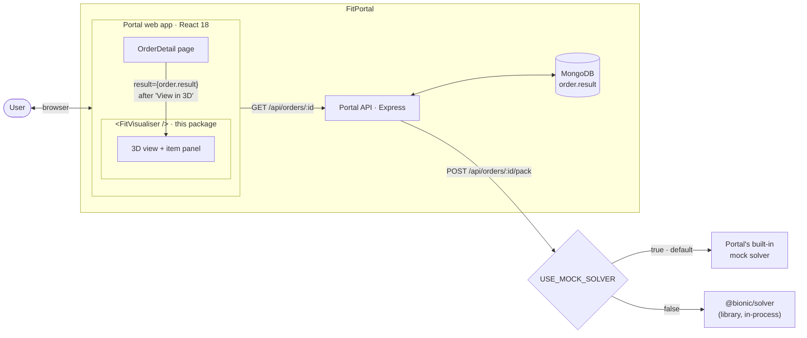
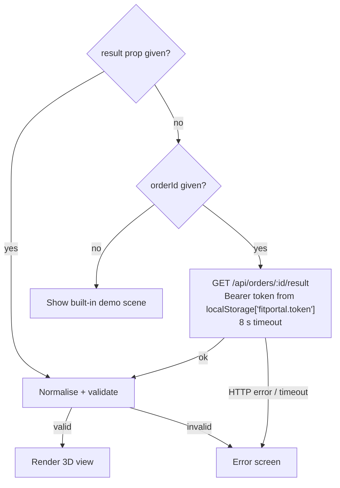
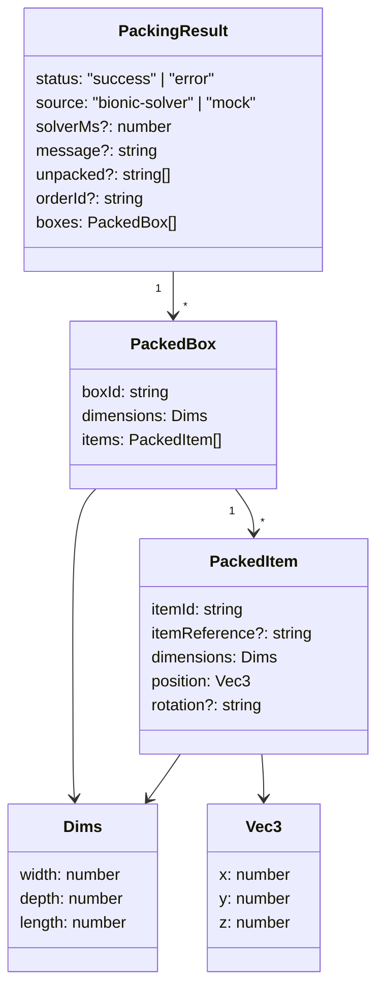
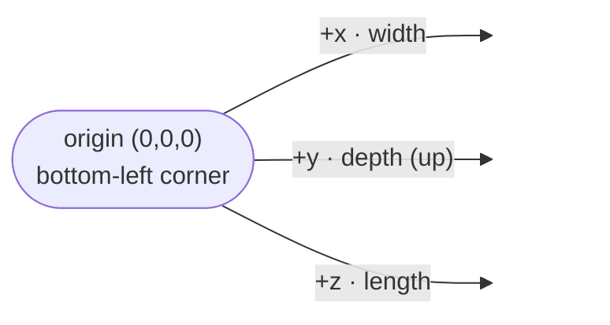
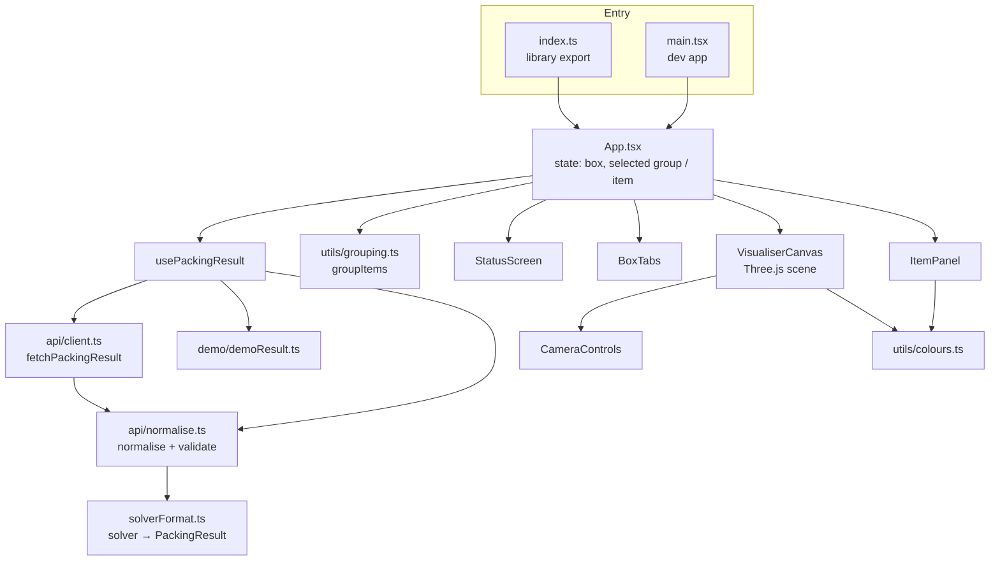
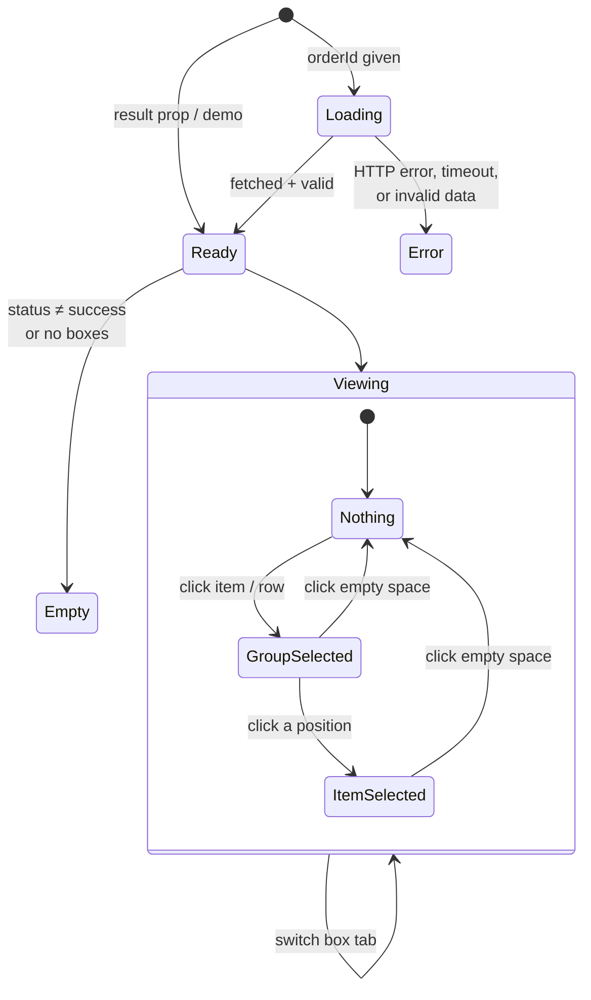
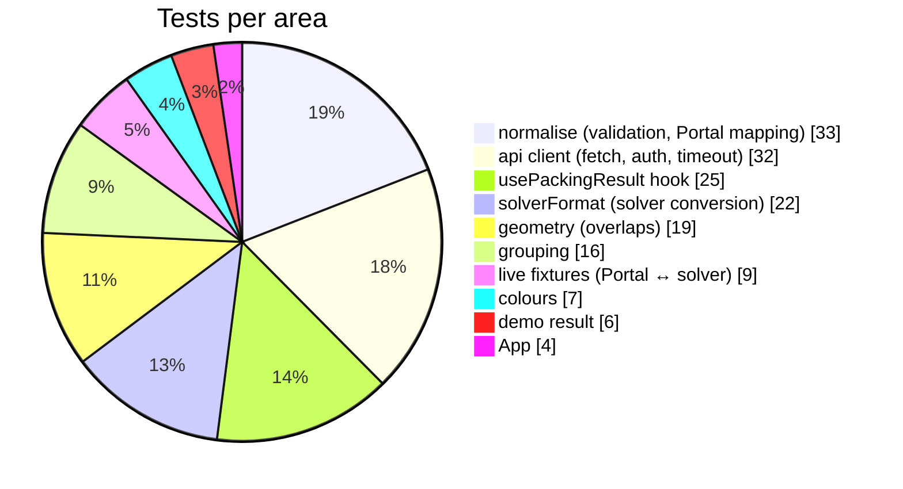
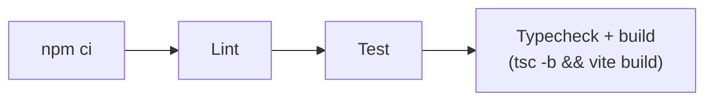

# Bionic Visualiser (FitVisualiser)

**COMP4050 Team Bionic: Visualisers project**

An interactive 3D viewer for box-packing results. It takes the output of the Bionic packing solver (directly, or through FitPortal) and shows each packed box in 3D: every item drawn at its real position and size, colour-coded by item type, and selectable from the 3D scene or the side panel.

It runs on its own as a Vite dev app, and it is also built as a **React component library** (`<FitVisualiser />`) that FitPortal mounts on its Order Detail page.


---

## Contents

- [Features](#features)
- [How it fits into the Bionic system](#how-it-fits-into-the-bionic-system)
- [Getting started](#getting-started)
- [Scripts](#scripts)
- [Using it as a component](#using-it-as-a-component)
- [Data formats](#data-formats)
- [Coordinate system](#coordinate-system)
- [Architecture](#architecture)
- [Controls](#controls)
- [Testing and CI](#testing-and-ci)
- [Project structure](#project-structure)
- [Team](#team)
- [Further docs](#further-docs)

---

## Features

- **3D packing view**: a translucent container with every item drawn as an outlined block, built with Three.js.
- **Multiple boxes**: one tab per box when an order uses more than one carton.
- **Item grouping**: identical items (same reference and size, even if rotated) collapse into one row, e.g. *"Shoebox 1, 2"*, and share a colour.
- **Selection both ways**: click an item in 3D to highlight it in the panel, or click a row or position in the panel to highlight it in 3D. Everything else fades.
- **Unpacked items**: items the solver couldn't fit (e.g. a piano in a shoebox order) are listed in a note under the item list.
- **Accepts several input formats**: FitPortal results (`width/depth/length` or `w/h/d`), and raw solver output (camelCase or snake_case, flat or nested placements).
- **Validation**: rejects negative or zero sizes and items placed outside their box, with a readable error listing each problem.
- **Fetching**: can load a result by `orderId` from the Portal API, with a Bearer token, an 8 s timeout and clear error messages.
- **Demo mode**: with no props, it renders a built-in demo scene so you can work on the UI without a backend.

---

## How it fits into the Bionic system

FitVisualiser isn't a separate service. It's a **package that FitPortal installs** and renders as a component inside its own React frontend, on the Order Detail page.

Portal's `web/package.json` installs it **straight from this GitHub repo** under the name `@bionic/visualiser`, pinned to a branch (as of 21 Oct 2026):

| Portal branch | Dependency in `web/package.json` |
|---|---|
| `main` | `github:subham-dahal/visualiser-bionic-#refactor/app` |
| `feature/ui-redesign` | `git+https://github.com/subham-dahal/visualiser-bionic-.git#integration/portal-api` |

When npm installs from git, it runs this repo's `prepare` script (`npm run build`), so Portal always gets a fresh `dist/` build. To ship an update, push it to the branch Portal points at, then run `npm install` in Portal.



1. **Packing:** when an order is packed, Portal's server runs either its built-in mock solver (the default, `USE_MOCK_SOLVER=true`) or the real `@bionic/solver` library, then saves the result on the order in MongoDB as `order.result`.
2. **Display:** the Order Detail page loads the order, including `order.result`. When the result's `status` is `"success"`, a *3D Visualization* card appears, and clicking **View in 3D** mounts `<FitVisualiser result={result} />`. This is the `result` prop mode.
3. **Alternative:** the component can also be given just an `orderId`. It then fetches `GET /api/orders/:id/result` itself, reusing Portal's login token from `localStorage['fitportal.token']`. That endpoint returns `{ orderId, reference, status, message, boxes, unpacked }`.

Results from the mock solver have `source: "mock"`, and the visualiser's header then shows *"· mock solver"*. The visualiser never talks to the solver directly. It also runs on its own (`npm run dev`) for development and demos.

---

## Getting started

### Prerequisites

| Tool | Version | Notes |
|---|---|---|
| Node.js | **24+** (team uses 26.7.0) | CI runs on Node 24 |
| npm | 11+ | Ships with Node |

<details>
<summary><b>Installing Node on macOS (nvm)</b></summary>

```bash
# Install nvm
curl -o- https://raw.githubusercontent.com/nvm-sh/nvm/v0.40.6/install.sh | bash
\. "$HOME/.nvm/nvm.sh"   # instead of restarting the shell

# Install Node
nvm install 26
node -v   # v26.7.0
npm -v    # 11.19.0
```
</details>

<details>
<summary><b>Installing Node on Windows (Chocolatey)</b></summary>

```powershell
powershell -c "irm https://community.chocolatey.org/install.ps1|iex"
choco install nodejs --version="26.7.0"
node -v   # v26.7.0
npm -v    # 11.19.0
```
</details>

### Run locally

```bash
git clone https://github.com/subham-dahal/visualiser-bionic-.git
cd visualiser-bionic-
npm install
npm run dev
```

| URL | What it is |
|---|---|
| http://localhost:5173/ | The visualiser app (demo scene by default) |
| http://localhost:5173/docs/prototype/index.html | The original rendering prototype |

### Connecting to a local FitPortal (optional)

Copy the example env file and point it at Portal's API:

```bash
cp .env.local.example .env.local
# VITE_PORTAL_API_BASE=http://localhost:4000
```

During `npm run dev`, Vite proxies every `/api/*` request to that address, so there are no CORS problems.

> **Install problems?** Delete and reinstall:
> `rm -rf node_modules package-lock.json && npm install` (macOS/Linux), or remove the same two items in PowerShell on Windows.

---

## Scripts

| Command | What it does |
|---|---|
| `npm run dev` | Start the Vite dev server with hot reload |
| `npm test` | Run the full Vitest suite once |
| `npm run test:watch` | Run tests in watch mode |
| `npm run lint` | ESLint (TypeScript and React Hooks rules) |
| `npm run build` | Type-check (`tsc -b`) and build the library into `dist/` |
| `npm run preview` | Serve the production build locally |

---

## Using it as a component

`npm run build` produces a library bundle with the CSS inlined into the JS, so the host only imports the component:

| File | Format |
|---|---|
| `dist/fit-visualiser.js` | ES module |
| `dist/fit-visualiser.cjs` | CommonJS |

`react`, `react-dom` and `three` are **peer dependencies**. They aren't bundled, and the host app provides them.

```tsx
import FitVisualiser from '@bionic/visualiser'

// Mode 1 (recommended): pass a result the host already has
<FitVisualiser result={order.result} />

// Mode 2: let the visualiser fetch it
<FitVisualiser orderId={order._id} apiBase="http://localhost:4000" />
```

### Props

| Prop | Type | Description |
|---|---|---|
| `result` | `PackingResult` | A result the host already fetched. **Takes priority** over `orderId`. |
| `orderId` | `string` | Fetches `{apiBase}/api/orders/{orderId}/result` when no `result` is given. |
| `apiBase` | `string` | Base URL for the Portal API. Defaults to `''`, so requests go to `/api/...` on the same origin as the page. |

### Which data source gets used



More integration notes are in [INTEGRATION.md](INTEGRATION.md).

---

## Data formats

Everything gets converted into one internal shape, `PackingResult` ([src/types/packing.ts](src/types/packing.ts)):



### Accepted inputs

[`normalisePackingResult`](src/api/normalise.ts) detects the format from the top-level keys:

| Input | Detected by | Handled by | Notes |
|---|---|---|---|
| FitPortal result | `boxes[]` | `fromPortalResult` | Dimensions as `{width, depth, length}` **or** Portal's `{w, h, d}` |
| Raw solver output | `results[]` | [`fromSolverOutput`](src/solverFormat.ts) | camelCase or snake_case, flat or nested `placement.item` |
| Wrapped payload | `result: {…}` | Unwrapped, then re-detected | |
| Anything else | n/a | `NormaliseError` | The message lists the keys it found |

Solver-specific handling:
- **Duplicate box names** (e.g. two `"Crate"` boxes) get renamed `Crate`, `Crate-2`, … so each `boxId` is unique.
- **Box sizes** are worked out from the furthest edge of the placed items on each axis when the solver doesn't supply them.
- **`failed`** items (strings or full records) become `unpacked`.

After conversion, **`validatePackingResult`** checks every box and item. All sizes must be positive numbers, and each item must sit inside its box (with 0.01 mm of rounding tolerance). Every problem found is collected into `NormaliseError.issues`.

Sample payloads for each format are in [src/fixtures/](src/fixtures/README.md), including real captures from the solver and Portal.

---

## Coordinate system

All sizes and positions are in **millimetres**. The origin `(0, 0, 0)` is the **bottom-left corner** of the box, and each item's `position` is the corner of the item nearest that origin.

| Axis | Size field | Portal `w/h/d` | Direction |
|---|---|---|---|
| `x` | `width` | `w` | across |
| `y` | `depth` | `h` | **vertical (up)** |
| `z` | `length` | `d` | front to back |



An item fits when, on every axis, `position + size ≤ box size`. The mapping was confirmed with the Portal team (X = width, Y = depth/vertical, Z = length), and [live.test.ts](src/api/__tests__/live.test.ts) checks that the solver and Portal captures of the same order produce an identical scene. Item sizes arrive already rotated, so they render as-is, and the `rotation` value (e.g. `"XYZ"`) is shown in the panel for reference.

---

## Architecture



### What happens on screen



### Key modules

| Module | Responsibility |
|---|---|
| [App.tsx](src/App.tsx) | Top-level layout. Holds the active box and the selection, and resets them when a new result arrives. |
| [usePackingResult.ts](src/packing/usePackingResult.ts) | Picks the data source (prop, fetch or demo) and ignores responses for an old `orderId`. |
| [api/client.ts](src/api/client.ts) | `fetch` with auth header, timeout, and `ApiError` carrying the HTTP status. |
| [api/normalise.ts](src/api/normalise.ts) | Format detection, Portal mapping and validation. |
| [solverFormat.ts](src/solverFormat.ts) | Converts raw solver output, gives duplicate box names unique IDs, and fills in missing box sizes. |
| [utils/grouping.ts](src/utils/grouping.ts) | Groups identical items (rotation doesn't matter), builds labels, and assigns colours by reference. |
| [utils/colours.ts](src/utils/colours.ts) | Generates distinct colours by stepping round the colour wheel at the golden angle (137.5°). |
| [api/geometry.ts](src/api/geometry.ts) | Overlap checks between items' bounding boxes (`findOverlaps`). |
| [VisualiserCanvas.tsx](src/components/VisualiserCanvas.tsx) | The Three.js scene, orbit camera, click-to-select and highlighting. |
| [ItemPanel.tsx](src/components/ItemPanel.tsx) | Item list, details of the selected item and positions, and unpacked items. |

---

## Controls

| Action | Mouse / touch | Keyboard / buttons |
|---|---|---|
| Rotate | Drag | Arrow keys (about 7° per press), or the ▲ ◀ ▶ ▼ pad (15° per tap) |
| Zoom | Scroll / pinch | **+** / **−** buttons |
| Orbit | The camera stays centred on the box, so it can't be lost off-screen | n/a |
| Reset camera | n/a | **Reset view** |
| Select item | Click it in 3D, or click its row in the panel (click again to deselect) | **‹ Prev** / **Next ›** in the panel |
| Select a single unit in a group | Click its position in the panel | n/a |
| Clear selection | Click empty space | n/a |
| Switch box | Box tabs (shown when there are 2+ boxes) | n/a |

---

## Testing and CI

**173 tests across 10 files**, run with Vitest and jsdom, plus React Testing Library for components.



The demo scene is tested to make sure it has no overlapping items and that everything fits inside its box. The live fixture tests check that a real solver capture and a real Portal capture of the same order render identically.

### CI pipeline

Every pull request, and every push to `main`, runs [.github/workflows/ci.yml](.github/workflows/ci.yml) on Node 24, with read-only repository access:



A PR should only be merged once this check is green.

---

## Project structure

```
visualiser-bionic-/
├── .github/workflows/ci.yml   # Lint → test → build on every PR
├── docs/
│   ├── minutes/               # Weekly meeting minutes
│   ├── prototype/             # Original plain Three.js prototype
│   └── ProjectDescription.pdf
├── public/                    # Favicon and icons
├── src/
│   ├── index.ts               # Library entry: default export + types
│   ├── main.tsx               # Dev-app entry
│   ├── App.tsx                # Top-level component
│   ├── solverFormat.ts        # Raw solver output → PackingResult
│   ├── api/                   # client, normalise, geometry (+ tests)
│   ├── components/            # BoxTabs, CameraControls, ItemPanel,
│   │                          # StatusScreen, VisualiserCanvas (+ CSS)
│   ├── demo/                  # Built-in demo scene
│   ├── fixtures/              # Sample solver / Portal payloads
│   ├── packing/               # usePackingResult hook
│   ├── styles/                # Base styles
│   ├── types/packing.ts       # PackingResult, PackedBox, PackedItem
│   └── utils/                 # grouping, colours
├── INTEGRATION.md             # How FitPortal mounts the component
├── vite.config.ts             # Dev proxy + library build
└── package.json
```

---

## Team

| Member | Role |
|---|---|
| Peter | Product Owner |
| Vaibhav | Repository |
| Sonny | Project Manager |
| Subham | Scrum Master |

### Contributing

1. Branch off `main` (e.g. `feature/…`, `fix/…`, `refactor/…`).
2. Run `npm run lint && npm test && npm run build` before pushing.
3. Open a pull request. CI must pass before it's merged. Don't push directly to `main`.
4. Don't commit `dist/`, `.env.local` or `.DS_Store`.

---

## Further docs

- [INTEGRATION.md](INTEGRATION.md): mounting `<FitVisualiser />` in FitPortal
- [REFACTOR.md](REFACTOR.md): notes for anyone pulling the restructure branch
- [src/fixtures/README.md](src/fixtures/README.md): sample payloads, edge cases and the axis decision
- [docs/minutes/](docs/minutes/): meeting minutes
